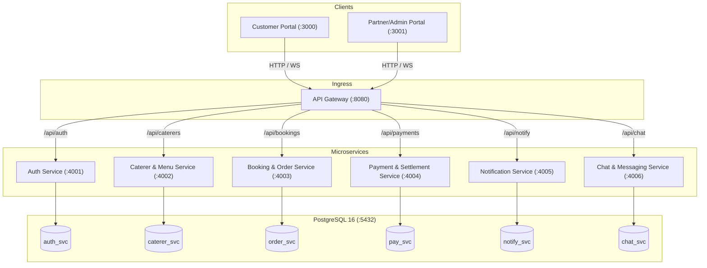

# CaterConnect System Architecture

## System Overview
CaterConnect is an enterprise two-sided catering marketplace connecting event hosts (customers) with verified caterers and administrators. The platform implements an **API Gateway Microservices Pattern** with a shared, logically partitioned relational PostgreSQL database.

## Component Responsibilities
1. **API Gateway (`backend/gateway`)**:
   - Single entry point on port `8080`.
   - Handles CORS, rate limiting, and SSL termination.
   - Verifies incoming client JWT tokens, strips spoofed headers, signs cryptographic HMAC internal tokens, and proxies requests to backend microservices.
2. **Auth Service (`backend/services/auth`)**:
   - Manages user registrations, bcrypt password hashing, Google SSO exchange, and JWT issuance.
3. **Caterer & Menu Service (`backend/services/caterer-menu`)**:
   - Manages caterer profile onboarding, kitchen master dishes catalog, package listings, city/state filtering, and min/max guest constraints.
4. **Booking & Order Service (`backend/services/booking-order`)**:
   - Handles party booking requests, custom combo recipe lists, caterer acceptance/rejection workflows, and state transitions (`requested` -> `accepted` -> `paid` -> `completed`).
5. **Payment Service (`backend/services/payment`)**:
   - Coordinates Razorpay orders, 25% advance vs. full payment splits, escrow holding, platform commission calculation, and automated settlements.
6. **Chat Service (`backend/services/chat`)**:
   - Manages thread creation per booking, bidirectional chat messaging between caterers and customers, and WebSocket streaming.
7. **Notification Service (`backend/services/notification`)**:
   - Delivers outbox events, transactional emails/SMS simulations, and browser push notifications.

## Data Flow
### Primary Request Path
1. Client issues HTTP request with `Authorization: Bearer <JWT>` to `http://129.225.70.124:8080/api/<resource>`.
2. Gateway verifies JWT via `fastify-jwt`, injects `x-user-id`, `x-user-role`, and signed `x-internal-token`, then forwards via `@fastify/http-proxy` to the targeted upstream service.
3. Microservice validates internal identity using `getAuthenticatedUser(req)`, queries its respective PostgreSQL schema partition via `pg.Pool`, and responds with structured JSON.
4. Gateway streams response back to the client.

### Chat & Inquiry Messaging Flow
1. Either Customer (from Caterer Profile / Order History) or Caterer (from Incoming Bookings / Chat Hub) requests `GET /api/chat/threads/booking/:bookingId`.
2. Chat service asserts caller is either the customer, caterer business owner, or admin.
3. Chat service looks up or inserts the thread in `chat_svc.chat_threads` with `ON CONFLICT (booking_id) DO UPDATE SET last_message_at = chat_threads.last_message_at RETURNING *`.
4. Messages are posted to `POST /api/chat/threads/:threadId/messages` and retrieved by `GET /api/chat/threads/:threadId/messages`.

## Key Architectural Constraints
- **Zero Cross-Service Direct HTTP**: Services do not make synchronous network calls to each other; coordination is achieved through shared database tables with foreign keys and gateway routing.
- **Tenant Isolation**: Caterers can only view bookings and chat threads belonging to their registered business (`c.owner_id = user.userId`).
- **No Non-UUID Fallbacks**: All thread and entity identifiers must be valid RFC 4122 UUIDs.
