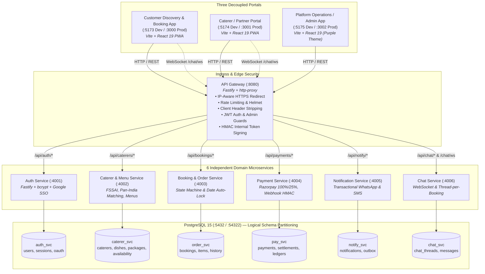
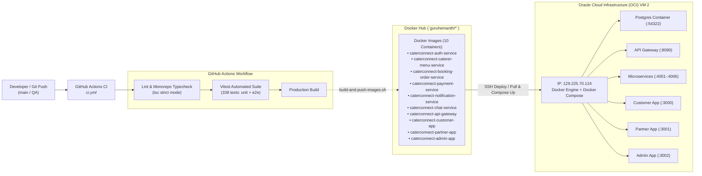

# CaterConnect System Architecture

## System Overview
CaterConnect is an enterprise, two-sided catering marketplace connecting event hosts (customers) with verified FSSAI-compliant caterers and platform administrators across India. The platform implements an **API Gateway Microservices Pattern** with three decoupled frontend client portals and a shared, logically partitioned relational PostgreSQL database.

---

## 1. Three Decoupled Portals

The frontend architecture separates concerns across three dedicated Vite + React 19 applications, eliminating monolithic UI coupling and ensuring strict role-based separation:

1. **Customer Discovery & Booking App (`frontend/customer`)**:
   - **Ports:** Dev `5173`, Docker Container `3000` (Nginx mapping port 80).
   - **Audience:** Event hosts (weddings, birthdays, corporate events).
   - **Key Features:** Pan-India location search (28 states, 8 UTs, city hubs), dynamic dish filter, custom combo builder, strict authentication booking gate (`<AuthRequiredModal />`), dual payment selection (100% full payment vs. 25% advance lock), and customer chat drawer.

2. **Caterer / Partner Portal (`frontend/partner`)**:
   - **Ports:** Dev `5174`, Docker Container `3001` (Nginx mapping port 80).
   - **Audience:** Caterers and commercial kitchen owners.
   - **Key Features:** 14-digit FSSAI onboarding, bank account & settlement setup, kitchen master dish catalog, package builder, calendar blackout date management, live booking acceptance/rejection, and partner chat hub.

3. **Platform Operations / Admin App (`frontend/admin`)**:
   - **Ports:** Dev `5175`, Docker Container `3002` (Nginx mapping port 80).
   - **Audience:** CaterConnect platform operators and super-admins.
   - **Key Features:** Completely decoupled standalone Vite application styled with an enterprise **Purple theme** (`#7c3aed` / violet accents). Hosts the Admin Operations Center: live platform GMV and 15% commission counters, caterer FSSAI verification queue (Approve/Reject with feedback), master booking audit log, dispute cancellation overrides, dynamic commission rules, and settlement ledger payout UTR entry.

---

## 2. API Gateway & Security Ingress (`backend/gateway`, Port 8080)

The API Gateway acts as the secure single point of entry for all external traffic. Built on Fastify with `@fastify/http-proxy`, it enforces:

- **Security Headers & Rate Limiting:**
  - `@fastify/helmet` with custom CSP controls.
  - `@fastify/rate-limit` enforcing global quotas (100 req/min) and strict throttling on sensitive authentication routes (`/api/auth/login`, `/api/auth/register` capped at 10 req/min). Whitelisted loopback addresses (`127.0.0.1`, `::1`).
- **IP-Aware HTTPS Redirect Logic:**
  - Evaluates `x-forwarded-proto` and conditionally redirects HTTP traffic to HTTPS via 301.
  - Automatically bypasses HTTPS redirect for local development (`localhost`, `127.0.0.1`) and direct Oracle VM IP accesses (`129.225.70.124`), ensuring seamless operations in both direct VM and reverse-proxied domain environments.
- **Header Sanitization & Anti-Spoofing:**
  - On every incoming request (`onRequest` hook), the gateway strips untrusted client headers: `x-user-id`, `x-user-role`, and `x-internal-token`.
- **Authentication & Role Guards:**
  - Public routes (`/health`, `/ready`, `/api/auth/*`, `/api/payments/webhook`, GET `/api/caterers/*`) bypass mandatory authentication.
  - Protected endpoints verify client JWTs via `fastify-jwt`.
  - Admin-only routes (`/api/caterers/admin/*`, `/api/payments/admin/*`) enforce `user.role === 'admin'`.
- **Internal Cryptographic HMAC Token Signing:**
  - Upon verifying a client JWT, the gateway signs a tamper-proof HMAC SHA-256 internal token (`signInternalToken(...)` from `@caterconnect/shared`) and forwards `x-user-id`, `x-user-role`, and `x-internal-token` to the target microservice.
  - Downstream microservices validate this token via `getAuthenticatedUser(req)`, guaranteeing requests originated from the trusted gateway.

---

## 3. Independent Domain Microservices

All microservices run on Fastify and Node 22, exposing isolated REST APIs and shared WebSocket endpoints:

| Service | Port | Database Schema | Primary Responsibilities |
| :--- | :---: | :--- | :--- |
| **Auth Service** | `4001` | `auth_svc` | User authentication, bcrypt password hashing (cost 10), Google OAuth token verification, profile management. |
| **Caterer & Menu Service** | `4002` | `caterer_svc` | FSSAI registration & validation, Pan-India multi-state location matching, master dish catalog, package builder, calendar blackout dates (`caterer_availability`). |
| **Booking & Order Service** | `4003` | `order_svc` | Booking state machine (`requested` -> `accepted` -> `paid` -> `completed` / `cancelled`), auto-date locking (`auto_locked = true`), guest tier adjustments. |
| **Payment Service** | `4004` | `pay_svc` | Razorpay order generation, dual payment schemes (100% Full vs 25% Advance Deal Lock), HMAC-SHA256 webhook processing, settlement ledger, UTR disbursements. |
| **Notification Service** | `4005` | `notify_svc` | Transactional WhatsApp deep-links, transactional SMS templates, event outbox dispatcher, push notifications. |
| **Chat & Messaging Service** | `4006` | `chat_svc` | In-app 1-to-1 messaging with thread-per-booking isolation (`chat_threads`), REST history, real-time bidirectional WebSocket streaming (`/chat/ws`). |

---

## 4. Database Architecture: Logical Schema Partitioning

The platform utilizes a single PostgreSQL 15 instance (`caterconnect`) with strict logical schema boundaries per service domain:

- **`auth_svc`**: `users`, `user_sessions`, `oauth_accounts`.
- **`caterer_svc`**: `caterers`, `menu_items`, `packages`, `package_items`, `caterer_availability`, `caterer_bank_details`.
- **`order_svc`**: `bookings`, `booking_items`, `booking_custom_dishes`, `booking_status_history`.
- **`pay_svc`**: `payments`, `settlements`, `commission_rules`, `payment_webhook_logs`.
- **`notify_svc`**: `notifications`, `notification_outbox`, `push_subscriptions`.
- **`chat_svc`**: `chat_threads`, `chat_messages`.

**Inter-Service Decoupling Principle:**
Microservices do not perform cross-service direct synchronous HTTP calls. Entity associations use relational foreign keys between schemas managed via migrations in `database/` (`01_init_schemas.sql` through `17_performance_indexes.sql`).

---

## 5. CI/CD & Production Topology

- **CI Pipeline (`.github/workflows/ci.yml`):** Automatically validates every push and pull request against `main` and `QA` branches via `pnpm install`, `pnpm run lint`, `pnpm run typecheck`, security audit, build, and comprehensive test suite execution (`pnpm run test --workspace-concurrency=1`).
- **Container Registry:** Pre-configured build automation (`scripts/build-and-push-images.sh`) bundles all 10 containers targeting `linux/amd64` and pushes to Docker Hub namespace `guruhemanth/*`.
- **Target Deployment Host:** Oracle Cloud VM 2 (`129.225.70.124`). Docker Compose orchestrates database volume persistence (`pgdata`), health-checked service startup sequences, and container port bindings.
