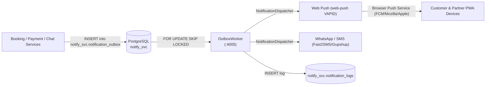

# Phase 10: Real-Time Web Push & Notification Dispatcher

## Objective
Harden and activate end-to-end real-time Web Push and notification outbox dispatching across CaterConnect:
1. Provide valid production VAPID key pairs (`VAPID_PUBLIC_KEY`, `VAPID_PRIVATE_KEY`, `VAPID_SUBJECT`) via `.env`, Docker Compose, and frontend build env.
2. Mount user-facing `<PushNotificationPrompt />` and `<PartnerPushNotificationPrompt />` components into the Customer Bookings Hub (`CustomerBookingsList.tsx`) and Partner Dashboard (`CatererDashboard.tsx`) so customers and caterers can activate instant browser notifications with 1-click.
3. Verify the Transactional Outbox worker background polling loop in `notification-service`, ensuring lifecycle events (`booking_requested`, `booking_accepted`, `booking_paid`, `booking_cancelled`, `chat_message`) trigger Web Push to subscribed devices and log into `notify_svc.notification_logs`.
4. Add comprehensive automated tests verifying push registration, outbox queue processing, unsubscription, and error handling for expired VAPID subscriptions.

---

## Architecture & Integration Points

---

## Detailed Task Breakdown

### Task 1: Environment & VAPID Key Configuration
- **Files to touch:**
  - `.env` & `.env.example`
  - `docker-compose.yml`
  - `frontend/customer/.env` & `frontend/partner/.env`
- **Actions:**
  - Configure `VAPID_PUBLIC_KEY`, `VAPID_PRIVATE_KEY`, `VAPID_SUBJECT=mailto:support@caterconnect.in` across service environments.
  - Expose `VITE_VAPID_PUBLIC_KEY` in frontend apps so `pushManager.subscribe` uses the matching server public key.

### Task 2: UI Mounting of Push Notification Prompts
- **Files to touch:**
  - `frontend/customer/src/features/customer/components/CustomerBookingsList.tsx`
  - `frontend/partner/src/features/caterer/CatererDashboard.tsx`
- **Actions:**
  - Mount `<PushNotificationPrompt />` above the bookings list tab in `CustomerBookingsList.tsx`.
  - Mount `<PartnerPushNotificationPrompt />` in the caterer incoming requests banner in `CatererDashboard.tsx`.
  - Provide clear status feedback: "Enable Alerts" -> "Push alerts enabled for your booking updates".

### Task 3: Notification Service Outbox Worker Hardening
- **Files to touch:**
  - `backend/services/notification/src/dispatcher.ts`
  - `backend/services/notification/src/outbox.ts`
  - `backend/services/notification/src/index.ts`
- **Actions:**
  - Ensure VAPID keys are cleanly passed to `NotificationDispatcher`.
  - Ensure `OutboxWorker.start(3000)` executes reliably in production container mode without unhandled rejections.
  - Ensure HTTP 404/410 expired subscriptions are removed from `notify_svc.push_subscriptions` automatically.

### Task 4: Automated Testing & Verification
- **Files to touch:**
  - `tests/e2e/tier1-feature-coverage/p1-10-push-notifications.test.ts` (or existing suites)
  - `backend/services/notification/tests/push-outbox.test.ts`
- **Actions:**
  - Verify subscription creation with VAPID application server keys.
  - Verify outbox batch processing with mock and live modes.
  - Verify graceful cleanup of uninstalled or expired subscriptions.
